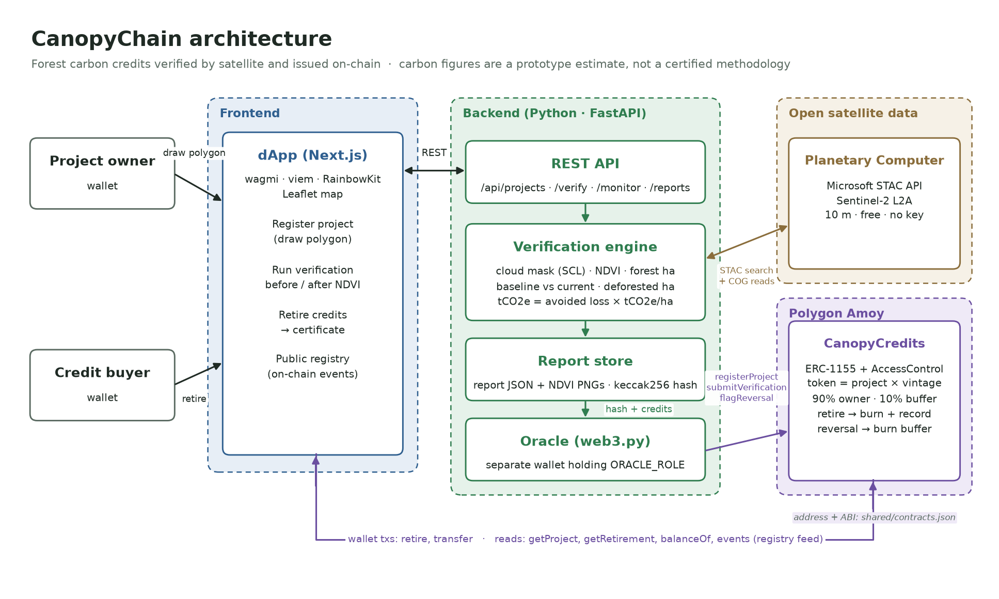

# CanopyChain

**Forest carbon credits verified by satellite and issued on-chain.** Submission for the **IEEE ClimateChain Global Hackathon 2026** (Tracks: Carbon Markets & Emissions Trading · Climate Data & Environmental Monitoring).

## Problem
Many forest carbon credits are over-issued, double-counted, or keep trading after the forest behind them is gone. Verification is manual, slow and opaque.

## Solution
- **Satellite verification:** Sentinel-2 NDVI analysis measures forest cover and deforestation for a project's polygon.
- **On-chain issuance:** an oracle posts the hash of each verification report, and the ERC-1155 credits are minted only against a verified report. 10% goes into a buffer pool.
- **Permanent retirement:** retiring burns credits and records a public certificate, so a credit can't be counted twice.
- **Ongoing monitoring:** if the forest is lost, the reversal is flagged on-chain and buffer credits are cancelled.
- **Public registry:** every issuance, retirement and reversal can be audited by anyone.

> The carbon methodology here is a prototype estimate, not a certified standard.

## Architecture


More detail: [overview](docs/overview.md) · [security](docs/security.md) · [climate impact](docs/impact.md) · [roadmap](docs/roadmap.md) · [API and contract interface](docs/api.md) · [deployment](docs/deploy.md) · [user testing](docs/user-testing.md)

## Repo layout
```
contracts/   Solidity + Hardhat (Polygon Amoy)
frontend/    Next.js dApp
backend/     FastAPI verification engine + oracle
shared/      Deployed contract ABI + address
docs/        API contract, architecture, security, impact docs
```

## Live deployment
- **dApp:** https://canopychain.vercel.app (connect MetaMask on Polygon Amoy)
- **Backend API:** https://canopychain-api.onrender.com/api/health (free plan: the first request after idle time can take about a minute)
- **Contract:** `CanopyCredits` on Polygon Amoy at [`0xeC75933ED22042090908Fd39E95afB90c644C4C2`](https://amoy.polygonscan.com/address/0xeC75933ED22042090908Fd39E95afB90c644C4C2) (address and ABI in [`shared/contracts.json`](shared/contracts.json))

## How to run
Requirements: Node 20+, Python 3.11+, Git. No API keys are needed for the satellite data.

**Quickest: everything on your machine with a local chain (no wallet funds needed)**
```bash
# 1. Contracts: start a local chain and deploy (leave the node running)
cd contracts && npm install && npx hardhat node
cd contracts && npm run deploy:local            # in a second terminal

# 2. Backend (third terminal). Hardhat's public test keys, never real ones.
cd backend && python -m venv .venv && .venv/Scripts/pip install -r requirements.txt   # macOS/Linux: .venv/bin/pip
CONTRACTS_JSON=../contracts/deployments/local.json AMOY_RPC_URL=http://127.0.0.1:8545 ORACLE_PRIVATE_KEY=0x59c6995e998f97a5a0044966f0945389dc9e86dae88c7a8412f4603b6b78690d CANOPY_APPROVERS=0x3C44CdDdB6a900fa2b585dd299e03d12FA4293BC .venv/Scripts/python -m uvicorn app.main:app --port 8000

# 3. Frontend (fourth terminal)
cd frontend && npm install && NEXT_PUBLIC_CHAIN=local npm run dev   # http://localhost:3000
```
In MetaMask add the network "Hardhat" (RPC `http://127.0.0.1:8545`, chain id 31337) and import Hardhat test account #2 (`0x5de4111afa1a4b94908f83103eb1f1706367c2e68ca870fc3fb9a804cdab365a`, a public test key). That account is an approver in this setup, so you can register a forest, approve it, verify it, retire credits and simulate deforestation.

**Against Polygon Amoy:** put `DEPLOYER_PRIVATE_KEY` and `ORACLE_ADDRESS` in `contracts/.env`, `ORACLE_PRIVATE_KEY` and `AMOY_RPC_URL` in `backend/.env`, then run the backend and `npm run dev` without the local-chain variables. The deployer wallet is the contract admin and therefore the approver. Details: [`backend/README.md`](backend/README.md), [`frontend/README.md`](frontend/README.md).

**Tests**
```bash
cd contracts && npx hardhat test        # 38 tests, 100% line and branch coverage
cd backend && .venv/Scripts/python -m pytest
cd frontend && npm run e2e              # full browser flow; needs the local stack above
```

## Team
- saaz: everything (contracts, frontend, verification engine, oracle)
